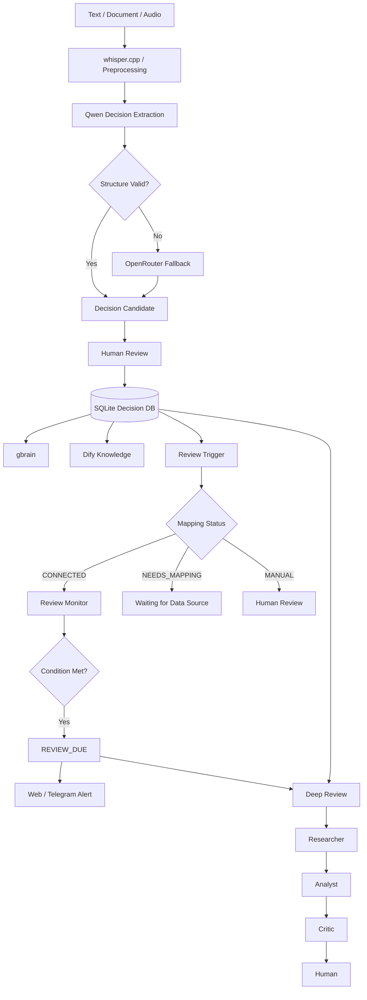

# Decision Pulse

> 회의에서 내려진 기술적 의사결정을 기억하고, **다시 검토해야 할 시점까지 추적하는 AI Decision Memory Agent**

회의록에는 많은 결정이 남지만 시간이 지나면  
**“그때 왜 이렇게 결정했지?”**, **“언제 다시 검토하기로 했지?”**를 놓치기 쉽습니다.

Decision Pulse는 텍스트·문서·음성 회의록에서 의사결정과 근거, 재검토 조건을 추출하고 사람이 승인한 결정만 저장합니다. 이후 실제 운영 지표를 모니터링해 재검토 시점을 감지하고, 필요할 경우 Multi-Agent Deep Review를 통해 기존 근거와 현재 상황을 다시 분석합니다.


---

## Why Decision Pulse?

예를 들어 회의에서 다음과 같은 결정이 내려질 수 있습니다.

> “MVP에서는 SQLite를 유지하죠.  
> 사용자가 1,000명을 넘으면 다시 검토합시다.”

일반적인 회의록에서는 이 문장이 기록된 뒤 잊히기 쉽습니다.

Decision Pulse는 이를 다음과 같이 관리합니다.

```text
회의록
  ↓
Decision Candidate 추출
  ↓
사람의 검토 및 승인
  ↓
Decision + Rationale + Review Trigger 저장
  ↓
운영 지표 모니터링
  ↓
user_count > 1000
  ↓
REVIEW_DUE
  ↓
Web / Telegram 알림
  ↓
Multi-Agent Deep Review
```

---

## Key Features

### 1. Decision Extraction

텍스트, 문서, 음성 회의록에서 다음 정보를 구조화합니다.

- Decision
- Rationale
- Assumptions
- Review Trigger
- Source / Evidence

로컬 **Qwen2.5-7B**를 기본 모델로 사용하고, 구조화에 실패한 경우에만 **OpenRouter 외부 모델**로 fallback합니다.

음성 회의는 **whisper.cpp**를 이용해 로컬에서 STT 처리합니다.

AI가 추출한 결과는 바로 Decision으로 저장하지 않습니다.

```text
AI Extraction
→ Candidate
→ Human Review
→ Approve / Edit / Ignore
→ Confirmed Decision
```

---

### 2. Review Trigger Monitoring

재검토 조건을 세 가지 상태로 구분합니다.

| 상태 | 의미 |
|---|---|
| `CONNECTED` | 실제 데이터 소스가 연결되어 자동 모니터링 가능 |
| `NEEDS_MAPPING` | 측정 가능한 조건이지만 아직 데이터 소스가 연결되지 않음 |
| `MANUAL` | 사람이 직접 판단해야 하는 조건 |

예:

```text
user_count > 1000
→ CONNECTED

deployment_count > 5 / 7d
→ NEEDS_MAPPING

"고객 불만이 많아지면 다시 검토"
→ MANUAL
```

`CONNECTED` 조건만 Review Monitor가 자동 평가합니다.

```text
ACTIVE
→ 조건 충족
→ REVIEW_DUE
→ Web Alert
→ Telegram Alert
```

재검토 조건의 판정은 LLM이 아닌 deterministic code로 처리합니다.

---

### 3. Decision Memory & Retrieval

승인된 Decision은 SQLite에 저장되며, 의미 기반 검색을 위해 **gbrain**과 동기화됩니다.

예:

```text
"사용자가 늘어나면 다시 검토해야 하는
데이터베이스 결정이 뭐였지?"
```

과거 Decision뿐 아니라 당시 근거와 재검토 조건까지 함께 조회할 수 있습니다.

**Dify Knowledge**와도 연동하여 RAG 기반 Decision 검색을 지원합니다.

---

## Multi-Agent Deep Review

재검토가 필요한 Decision은 세 개의 역할로 나누어 분석합니다.

```text
Evidence Researcher
        ↓
Decision Analyst
        ↓
Review Critic
        ↓
Human
```

### Evidence Researcher

원래 Decision, 근거, 전제, 현재 상태와 관련 과거 Decision을 수집합니다.

해석이나 최종 판단은 하지 않습니다.

### Decision Analyst

Researcher가 수집한 사실만 사용해 다음을 분석합니다.

- 기존 전제와 현재 상태의 차이
- 변화가 Decision에 미치는 영향
- 확인되지 않은 정보
- 추가 검토가 필요한 항목

### Review Critic

Analyst의 결과를 다시 검증합니다.

- 근거 없는 주장
- 사실과의 모순
- 빠진 검토 항목
- 과도한 해석

을 검사하고 `PASS` 또는 `REVISE`를 반환합니다.

`REVISE`는 최대 한 번만 허용하며, 이후에도 검증되지 않으면 `HUMAN_REVIEW_REQUIRED`로 종료합니다.

---

## Deep Review Governance

Deep Review는 **Paperclip**을 Multi-Agent control plane으로 사용합니다.

Paperclip은 AI 판단 자체를 담당하지 않고 다음을 관리합니다.

- Researcher → Analyst → Critic reporting line
- Agent별 ticket
- 실행 상태
- budget
- revision limit
- audit trail

Agent가 Decision DB를 직접 수정하는 것은 허용하지 않습니다.

```text
Agent Output
→ Schema Validation
→ Backend Deterministic Gate
→ Next Agent
```

최종 Decision 변경 권한은 항상 사람에게 있습니다.

---

## Human-in-the-Loop & Reliability

Decision Pulse에서 중요하게 둔 원칙은  
**“AI가 말했기 때문에 사실이 되는 구조를 만들지 않는 것”**입니다.

### Human approval

AI가 추출한 Candidate는 사람이 승인해야 Decision이 됩니다.

### Fact / Inference separation

DB에서 가져온 사실과 AI가 작성한 분석을 분리합니다.

```text
Authoritative Record
≠
AI Inference
```

### Read-only agent tools

Hermes Agent가 사용하는 Decision Debt MCP와 gbrain MCP는 읽기 전용으로 제한했습니다.

### Deterministic trigger evaluation

재검토 조건의 충족 여부는 LLM이 아닌 코드로 판정합니다.

### Evidence reference validation

Deep Review에서 AI가 사용하는 `FACT:*`, `E1` 등의 reference를 backend가 검증합니다.

존재하지 않는 근거를 인용하면 결과가 저장되지 않습니다.

---

## Evaluation

Single-Agent Review와 Multi-Agent Deep Review를 비교했습니다.

| Decision | Method | Evidence Coverage | Unsupported Claims |
|---|---|---:|---:|
| DEC-2026-0314-DB | Single | 1.00 | 측정 불가 |
| DEC-2026-0314-DB | Multi | 1.00 | 0 |
| DEC-2026-1106-DATABASE | Single | 0.67 | 측정 불가 |
| DEC-2026-1106-DATABASE | Multi | 1.00 | 0 |

Multi-Agent 방식에서는 Researcher와 Analyst의 결과를 Critic이 별도로 검증하도록 해 근거 누락과 unsupported claim을 확인할 수 있도록 했습니다.

### Test Status

- Backend: **169 tests passed**
- Frontend: **8/8 tests passed**
- ESLint: passed
- TypeScript typecheck: passed
- Production build: passed

---

## Tech Stack

### Frontend

- Next.js 16
- TypeScript
- Tailwind CSS

### Backend

- FastAPI
- SQLite
- Pydantic

### AI / LLM

- Qwen2.5-7B
- llama.cpp / llama-swap
- OpenRouter fallback
- whisper.cpp

### Agent / Retrieval

- Hermes Agent
- gbrain
- Dify
- Paperclip

### Notification

- Telegram Bot

---

## Architecture



---

## Example

### Original Decision

```text
MVP에서는 SQLite를 유지한다.
```

### Rationale

```text
초기 개발 속도를 우선한다.
```

### Review Trigger

```text
user_count > 1000
```

### Observed

```text
user_count = 1400
```

### Result

```text
ACTIVE
→ REVIEW_DUE
→ Telegram notification
→ Deep Review
→ PASS
```

---

## Project Structure

```text
decision-debt/
├── backend/
│   ├── services/
│   ├── agents/
│   ├── tests/
│   └── app.py
│
├── web/
│   └── Next.js application
│
├── agents/
│   └── deep-review/
│
├── paperclip/
│
├── docs/
│   ├── architecture/
│   └── evals/
│
├── dev.sh
└── stop.sh
```

---

## Design Principles

Decision Pulse는 다음 원칙을 기준으로 설계했습니다.

1. **AI output is not automatically a fact**
2. **Human approval before Decision confirmation**
3. **Deterministic logic for deterministic tasks**
4. **Read-only tools by default**
5. **Facts and AI inference must be distinguishable**
6. **Unknown information should remain unknown**
7. **AI agents never modify Decisions automatically**

---

## Current Limitations

현재 연결된 자동 지표는 제한적이며, 새로운 운영 지표는 adapter 연결이 필요합니다.

현재 실제 연결된 metric:

- `user_count`
- `search_api_p95_ms`
- `server_count`

향후 GitHub Actions, Prometheus, Stripe 등 외부 데이터 소스를 adapter 방식으로 연결할 수 있도록 설계했습니다.

---

## Status

Decision Pulse is an individual project developed as part of an AI Agent course.

Current focus:

- Decision extraction reliability
- Review Trigger monitoring
- Human-in-the-Loop workflow
- Evidence-grounded Multi-Agent review
- Evaluation and validation
